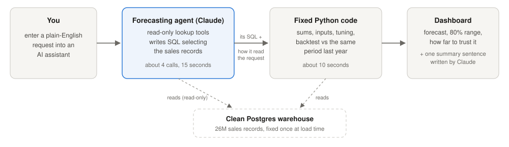

# demand-on-demand

**Ask for a demand forecast in plain English. Get a tested forecast and dashboard in under a minute.**

A business user types a question like *"monthly forecast of Tito's minis in Des Moines for the next 5 months"*.
A single Claude agent with read-only tools (the forecasting agent: Claude Sonnet 5 via the Claude API) turns the words
into one SQL query that picks the right sales records from a company-style Postgres warehouse built from the State of
Iowa's public liquor sales data ([details below](#the-data)). Fixed Python code then adds them up by week or month,
tunes and tests various machine learning (ML) models against a baseline model (which predicts whatever was
sold in the same period one year earlier), and publishes a dashboard that says how far to trust the answer.

| | |
|---|---|
| Plain English to dashboard | about 30 seconds |
| Claude API cost per request | about $0.03 |
| Forecast accuracy | median error 8% smaller than the baseline model |
| Agent accuracy | correct SQL on all 34 test requests, each run 3 times |

**Author:** Joseph M. Hahn, Ph.D., independent AI and machine learning consultant  
[jmh-datasciences.com](https://jmh-datasciences.com) · [LinkedIn](https://www.linkedin.com/in/hahnjoe) · joe.hahn@jmh-datasciences.com  
**Built end-to-end with Claude Code.** · **License:** [MIT](#license-and-data)

## The data

[Iowa Liquor Sales](https://data.iowa.gov/catalog?q=liquor+sales), published by the State of Iowa on the Iowa Data Hub.
Iowa is an alcohol control state, so liquor, grocery and convenience stores that sell liquor (spirits, not beer or
wine) must buy it from the state's Alcoholic Beverages Division (ABD). ABD tracks every one of those purchases and
publishes each as one record at the link above: date, store, product, bottles, dollars and liters. So the "sales"
here are what stores order, presumed to be a close proxy for what they sell, and they cover spirits only.

This project loads the January 2016 through August 2026 data into a Postgres warehouse (see Figure 1 below)
containing about 26 million sales records for almost 3,200 stores that are ordering about 13,000 distinct products.
This warehouse is representative of a real company's sales data, with real volume, real seasonality and real data
problems, but nothing confidential.

**Clean data, fixed once.** The public data has real problems, documented in this project's
[data exploration page](https://joehahn.github.io/demand-on-demand/data_exploration.html): the state's export repeats
1.5 million rows; category codes were reassigned in 2016 and a category was recoded in 2022; 254 products were
renumbered; a sleeve of 12 minis is counted as one bottle; liters were rounded down to whole liters for three
months; cities are spelled several ways. The data loader, [load_data.py](load_data.py), fixes each one once, in the warehouse, and the
[data fixes page](https://joehahn.github.io/demand-on-demand/data_fixes.html) shows before and after, so that
every forecast reads clean data.

## How the forecasting agent works



<p align="center"><em><b>Figure 1.</b> How a plain-English request becomes a tested forecast. Blue indicates where AI is used.</em></p>

**The AI decides what to forecast while fixed code handles everything else.** The forecasting agent has four tools:
(i) search the database for relevant products and places, (ii) try a test query on the data to see what it returns,
(iii) ask the user a clarifying question, and (iv) submit its SQL query to the fixed code. Take *"monthly forecast of
Tito's minis in Des Moines for the next 5 months"*. The search finds Tito's in seven bottle sizes, so the agent keeps
only the 50 ml minis: the single mini and the mini 4-pack. "Des Moines" is trickier: it could mean the city (131
stores), the city plus its neighbor West Des Moines (66 more), or all of Polk County, and a county-name search would
even match Des Moines County. And in this case the agent picks the city and says so on the dashboard, where the
requester can check it. It then writes one SQL query to select all of the relevant records and their measure,
which can be dollars, bottles or liters. The agent's instructions, [dod/agent.py](dod/agent.py), warn it about the
data's known peculiarities (product IDs and category codes that change at various times, and brand names written in
more than one way, such as Crown Royal barrel picks listed as "BP CROWN ROYAL"), and also include a short glossary to
help the agent disambiguate requests: "whiskey" does not include whiskey liqueurs such as Fireball, and "minis" are
50 ml bottles. The agent's tools are spelled out in [dod/tools.py](dod/tools.py).

**Fixed code does the arithmetic.** The agent's query only decides which records to pull from the database. Fixed
code then aggregates them over all the selected products and stores (or separately for each group compared, such as
Hy-Vee vs Costco) into weekly or monthly time buckets, plus totals by store and by product for the dashboard's map and
tables. So the AI never computes the numbers the models learn from.

The models always work in weeks or months. A request for two-week (biweekly) periods, quarters, half-years or years is answered by
adding up the weekly or monthly forecasts: two-week periods from weeks, the rest from months. Quarters and half-years follow
the calendar, so the one in progress combines the months already sold with the months still to come. "Next year"
means the next 12 months and "this year" the calendar year in progress. The models look at most 12 months (52 weeks)
ahead, the furthest that can still be tested honestly, and the dashboard says so when a request reaches further.

**The machine learning (ML) pipeline is the same for every request.** Fixed code trains, tunes and tests the models, and splits the
sales history into three periods:

- **Tuning** (the two years before the last two): 48 model configurations are compared. Two kinds of ML model,
  LightGBM (gradient-boosted trees) and ridge regression, predict either the sales level, the change from last month
  or the change from last year, with different lags and lengths of history. The best one, or the average of the best
  three, is kept, then blended with the baseline model only as far as that helps. Every forecast, weekly or monthly,
  is offered the same four inputs (time of year, business days and holidays, county population, active stores), and
  each is kept only if it helps; ridge regression sees time of year as a smooth yearly wave (sine and cosine),
  LightGBM as the month number ([benchmark/menu.md](benchmark/menu.md)).
- **Testing** (the last 24 months): the chosen models forecast each week or month using only data from before it, and their
  errors are compared with the baseline's. These are the accuracy figures on every dashboard, and nothing in this
  period was used to make any choice.
- **Forecast**: the same tuning is repeated on the latest two years, so the settings behind the forecast come from
  the most recent data.

The baseline model is always one of the candidates, so the dashboard uses an ML model only when it beats the baseline.

**The dashboard is fixed code too**, with the same layout for
every request. The AI's only contributions to it are its reading of the request (the title and its assumptions), its
SQL, shown exactly as run, and the one-sentence summary, written by a second short Claude call using only numbers the
models computed.

**Fast because of the database, not the model.** AI-written SQL is only as fast as the database it runs on. One index
on the sales records, by product and then store, lets a request like "Fireball in Linn County" read its 98,000 sales
instead of all 1.2 million Fireball sales in Iowa: those queries went from about a minute to under a second, with
identical results. A typical forecast now builds from plain English in under 35 seconds.

**Least privilege.** Postgres runs with password authentication and separate roles. The forecasting agent's login can only read
the clean tables, with a query time limit. Credentials live in `.env`, are read by Python, and never appear in a prompt.

## See it live

- **[Data exploration](https://joehahn.github.io/demand-on-demand/data_exploration.html)**: what 26 million orders look like: volume by day, month and
  year, seasonality (flat statewide, 3x to 8x swings in slices like cream liqueurs and gift packs), and every data
  problem found while loading.
- **[Data fixes](https://joehahn.github.io/demand-on-demand/data_fixes.html)**: each problem, the fix applied once in the warehouse, and before and after.
- **[Data dictionary](https://joehahn.github.io/demand-on-demand/data_dictionary.html)**: every table and column, exactly as the
  forecasting agent is told about them at the start of each request (written once by the loader, stored as database comments).

**Example forecasts.** Each was made by the forecasting agent from the plain-English request shown.
Each dashboard is one page with how the request was read, the forecast chart and table (with an 80% range), the
backtest against the same period last year, the table the model learns from, which inputs helped, a map of the stores
included, the 48 model configurations compared, every tool call the agent made, and the exact SQL that ran.

| request | backtest vs same period last year | built from scratch |
|---|---|---|
| [Monthly forecast of Tito's minis in Des Moines for the next 5 months](https://joehahn.github.io/demand-on-demand/examples/tito_s_minis_des_moines_next_5_months.html) | 16% more accurate | 23 s, $0.03 |
| [What revenue should we expect from Fireball in Linn County next quarter?](https://joehahn.github.io/demand-on-demand/examples/fireball_linn_county_next_quarter.html) | 8% more accurate | 24 s, $0.05 |
| [How many bottles of cream liqueur will Iowa stores order for the holidays?](https://joehahn.github.io/demand-on-demand/examples/cream_liqueur_holidays.html) | 30% more accurate | 22 s, $0.02 |
| [show me weekly forecast of Cream liqueur bottles sold across all of iowa, twelve weeks out](https://joehahn.github.io/demand-on-demand/examples/cream_liqueur_by_week_next_12_weeks.html) | 18% more accurate | 32 s, $0.01 |
| [Quarterly forecast of Tito's sales dollars at stores that have never ordered Fireball, next 4 quarters](https://joehahn.github.io/demand-on-demand/examples/titos_at_stores_without_fireball_next_4_quarters.html) | 11% more accurate | 26 s, $0.05 |

Not every forecast beats last year: the [benchmark report](benchmark/report.md) lists all 30 sampled forecasts,
misses included, and when a model does not beat last year its dashboard says so.

Requests can ask for weeks, two-week (biweekly) periods, months, calendar quarters, half-years, the next 12 months or the calendar
year in progress, and can select anything SQL can express, such as the stores in the last example.

## Using an AI agent + forecasting for market analysis

Suppose you manage the Hy-Vee stores in Ankeny and worry that your liquor sales are going down. Start Claude Code in this
folder and paste these five requests one at a time. Claude Code is the assistant you talk to: it hands forecast
requests to the forecasting agent (taking about 30 seconds to generate a forecast). It answers quick lookups and
chart requests itself, from the database (read-only) or from the forecast just made. Other coding assistants that can run commands in this folder
should be able to follow the same steps: the instructions they need are in [AGENTS.md](AGENTS.md). Chat-only
assistants would reach the forecasting agent through an MCP server, which would sit between the first two boxes of
Figure 1 (see [From any AI assistant](#from-any-ai-assistant)).

**1. Confirm the worry**

```text
Show a table of total liquor sales by year for all Hy-Vee stores in Ankeny, no forecast.
```

A quick lookup with no forecast, and the results confirm the concern: Ankeny's Hy-Vees peaked at about $4.9 million
in 2020 and have fallen every year since, to $3.9 million in 2025, about 20% down.

**2. Test a hunch with a forecast**

```text
Costco arrived in Ankeny in 2023 I think, so show monthly liquor dollars in Ankeny:
Hy-Vee vs Costco vs all other stores, next 6 months, but have all charts start in year 2017
```

The forecasting agent builds a dashboard with one forecast per group. Costco's chart is empty until its line appears,
and the agent points out that Costco actually started selling liquor in October 2022, a little earlier than
remembered.

**3. See the years side by side**

```text
Plot annual liquor sales of Hy-Vee vs Costco vs all other stores in Ankeny, with 2026 showing actuals plus forecast
```

A chart Claude Code builds from the forecast it just made, with no new forecasting. Hy-Vee shrinks after 2020, Costco
climbs to about $2.1 million a year, and all the other stores keep growing.

**4. Measure it**

```text
Also overlay Hy-Vee's market share on that plot
```

Hy-Vee held about 43 to 45% of Ankeny's liquor sales through 2021, then fell to 29% from 2022 on, the year Costco
arrived. Hy-Vee lost about a third of its share in four years.

**5. Find the cause**

```text
Which other Ankeny stores grew the most?
```

Another quick lookup, and the twist: not just Costco. Five new local liquor stores opened since late 2021, led by one
that went from nothing in 2023 to $1.1 million in 2025, while Sam's Club lost about $1 million a year, likely to Costco.

Five plain-English questions take a manager from "I think it's Costco" to a new set of competitors they didn't know to
ask about. The tool shows where, how much and how far to trust each forecast; the person works out what to do.

**Other requests to try**

- *Monthly liquor dollars for each Hy-Vee store in Ankeny, next 6 months*: one forecast per store, ranked.
- *Monthly Hy-Vee bottles of each Jose Cuervo product, next 6 months*: dozens of products, ranked by forecast change.
- *Monthly Fireball mini bottles at Casey's stores vs Hy-Vee stores, next 6 months*: two chains defined only by store
  name.
- *Monthly Tito's sales dollars for each of the 5 largest counties, next 6 months*: the forecasting agent finds the
  counties.
- *What tequila revenue should Polk County stores expect next quarter?*: a turning point, where the page says plainly
  the model is no better than last year's numbers.

## From any AI assistant

At a firm, employees would ask their own assistant, not open this repo. Coding assistants that can run commands in this
folder (Claude Code, Codex, Copilot and others) get their instructions from [CLAUDE.md](CLAUDE.md) or
[AGENTS.md](AGENTS.md). For chat-only assistants the next step (not built yet) is a small MCP server: MCP is the open
standard for giving AI assistants tools, supported by Claude Desktop, Claude Code and Microsoft Copilot Studio among
others. It would offer one tool, "forecast demand from a plain-English request", running on a firm machine with the
warehouse, and return the summary and a link to the dashboard. In Figure 1 it would sit between the first two boxes:
the request goes from the employee's assistant, through the MCP server, to the forecasting agent. The assistant then only passes the question along: the
forecasting agent's SQL, the models and the trust check stay in this governed, tested code, whichever assistant the
firm uses.

## Results

- [benchmark/report.md](benchmark/report.md): 30 forecasts sampled from the warehouse (products, categories, vendors;
  counties and statewide; bottles, dollars, liters; 3 to 12 months), run through the same fixed code as every forecast.
  The model beat "same month last year" on 18, with a median and mean error 8% lower. Iowa liquor
  demand is very regular year to year, so last year is a hard baseline, and on the other 12 it was not beaten. The report lists every forecast, the
  misses included.
- [evals/sql_report.md](evals/sql_report.md): the forecasting agent's SQL scored against an answer key: 34 requests (brands, categories, minis, cities, counties, a 207-store chain, weeks,
  quarters, a year, and requests it should decline), 3 runs each. The sales records its SQL selected, summed by month,
  matched the key in every month in all 102 runs, and all 102 read the grain and horizon right.
- [evals/grounding.md](evals/grounding.md): each dashboard's summary opens with one sentence written by Claude from the
  forecast's computed numbers (the accuracy sentence and every other number come from fixed code). This check traces
  every number in such sentences back to the computed results: 144 of 144 matched (48 forecasts, 3 runs each, 2026-10-13).
- [HISTORY.md](HISTORY.md): how the forecasting agent got there, from an AI-filled request form to AI-written SQL
  checked against an answer key.

## Run it yourself

Needs Python 3.12, Postgres 17, about 20 GB of disk, and an Anthropic API key.

```bash
brew install postgresql@17 python@3.12 && brew services start postgresql@17
python3.12 -m venv .venv && .venv/bin/pip install -r requirements.txt
# create the database and roles (see "Database access" in CLAUDE.md), then:
cp .env.example .env          # add ANTHROPIC_API_KEY and the two Postgres connection strings
.venv/bin/python load_data.py                    # download, load, clean: about 20 minutes, 13 GB
.venv/bin/python explore_data.py && .venv/bin/python data_fixes.py
.venv/bin/python -m dod.forecast "weekly forecast of Tito's minis in Des Moines for the next 8 weeks"
```

The dashboard lands in `out/<title>/dashboard.html`. `python -m dod.agent "<request>" --sql-only` shows only the
forecasting agent's part: its SQL and how it read the request.

## Repo map

| path | what it does |
|---|---|
| `load_data.py` | one-time pull of Iowa Liquor Sales 2016 onward into Postgres: raw, curated star schema, Census reference tables, the clean stage, and the data dictionary |
| `explore_data.py`, `data_fixes.py`, `data_dictionary.py` | the three data pages in `docs/` |
| `dod/agent.py`, `dod/tools.py`, `dod/plan.py` | the forecasting agent, its read-only tools, and its reading of the request |
| `dod/db.py`, `dod/sqlcheck.py` | the read-only database login and the check that every query is one read-only SELECT |
| `dod/forecast.py`, `dod/history.py`, `dod/features.py`, `dod/model.py`, `dod/periods.py`, `dod/dashboard.py`, `dod/viz.py` | fixed code: sums, inputs, models, report periods (quarters, half-years, years), dashboard and chart style |
| `dod/results.py` | a finished forecast's actuals and forecasts as tidy tables, for follow-up charts |
| `dod/spec.py`, `dod/panel.py` | reference queries from hand-checked request forms, for the answer key and the benchmark |
| `evals/`, `benchmark/` | the answer key and SQL score, summary grounding, forecast-accuracy benchmark and experiments |
| `make_examples.py`, `demo.py` | the published example dashboards; canned requests for a live demo |
| `CLAUDE.md`, `PLAN.md`, `HISTORY.md` | the working notes Claude Code built this from, and how the agent's design evolved |
| `AGENTS.md` | the same answering rules for other AI coding assistants |

## About the author

I am Joseph M. Hahn, Ph.D., an independent AI and machine learning consultant. Through **JMH DataSciences** I build
production AI and machine learning systems for clients who need a real decision automated, not a demo. Before going
independent I spent eight years inside Oracle's AI Center of Excellence delivering AI systems for enterprise clients
in manufacturing, oil and gas, public sector, and retail.

This repo shows a pattern I use: let an AI agent handle the part people find tedious, turning a vague request into a
precise query, test that query against an answer key, and keep everything that has to be trustworthy in fixed, tested
code. If your business still builds
forecasts by hand, [let's talk](https://jmh-datasciences.com).

Related work: [chicago_crime_forecast](https://github.com/joehahn/chicago_crime_forecast) (one model for a thousand
time series) · [diplomacy-A2A](https://github.com/joehahn/diplomacy-A2A) (seven Claude agents negotiating).

## License and data

Code and writing: [MIT](LICENSE).

**Data:** [Iowa Liquor Sales](https://data.iowa.gov/catalog?q=liquor+sales), State of Iowa, via the Iowa Data
Hub, licensed [CC BY 4.0](https://creativecommons.org/licenses/by/4.0/); modified (duplicates removed, cleaned,
aggregated). County population and income: U.S. Census Bureau. Not endorsed by the State of Iowa. Brand names appear
only as they do in the public data. Raw data is not stored in this repo; the loader downloads it.
