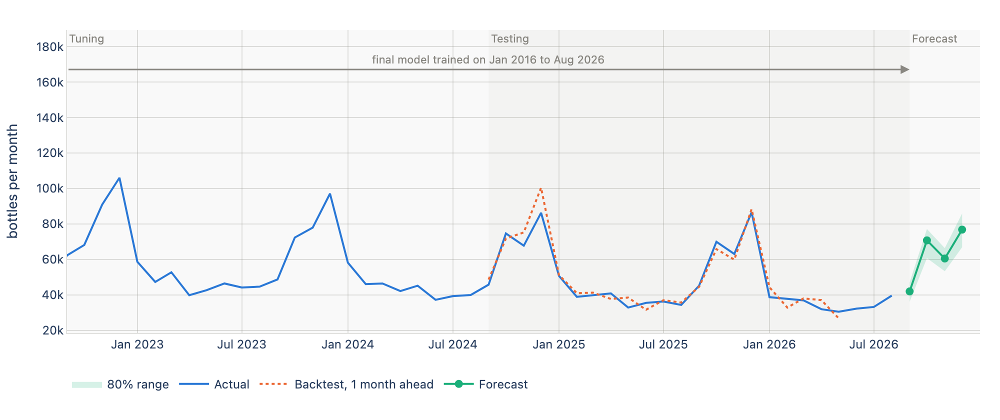
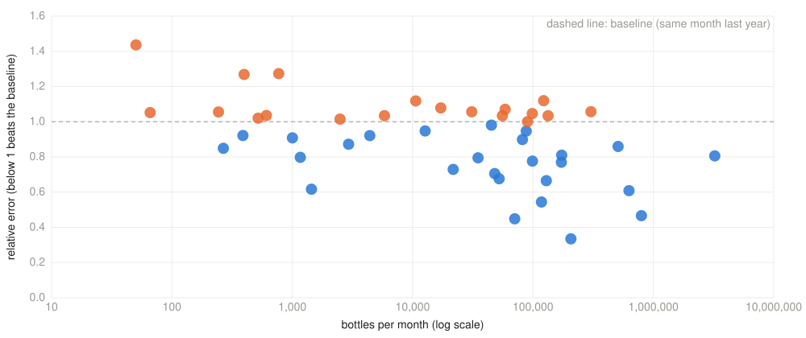

# demand-on-demand

**Ask for a demand forecast in plain English, get a tested forecast and dashboard in under a minute.**

A business user types a question like *"monthly forecast of Tito's minis in Des Moines for the next 5 months"*.
A single Claude agent with read-only tools turns the words into one SQL query that selects the required sales
records from a company-style Postgres warehouse built from the [State of Iowa's public liquor sales data](#the-data). Deterministic Python code then sums those transactions by week or month, tunes and tests
various machine learning models against a simple baseline model, and publishes a dashboard that says how far to trust the
answer.

| | |
|---|---|
| Plain English request to dashboarded results | about 30 seconds |
| Claude API cost per request | about $0.03 |
| Forecast accuracy | median error 8% smaller than the baseline model |
| Agent accuracy | correct SQL on all 34 test requests, each run 3 times |

**Author:** Joseph M. Hahn, Ph.D., independent AI and machine learning consultant  
[jmh-datasciences.com](https://jmh-datasciences.com) · [LinkedIn](https://www.linkedin.com/in/hahnjoe) · joe.hahn@jmh-datasciences.com  
**Built end-to-end with Claude Code.** · **License:** [MIT](#license-and-data)

## The data

The [Iowa Liquor Sales](https://data.iowa.gov/catalog?q=liquor+sales) dataset is published by the State of Iowa and
made available via the [Iowa Data Hub](https://data.iowa.gov/). Iowa is an alcohol control state, so stores that sell liquor (spirits, not
including beer or wine) must buy it from the state's Alcoholic Beverages Division (ABD). ABD tracks every one of those
purchases and publishes each as one record at the link above: date, store, product, bottles, dollars and liters. So
the "sales" here are what stores order, and are assumed here to be a close proxy for what those stores actually sell.

This project loads the January 2016 through August 2026 Iowa liquor sales data into a Postgres warehouse (see Figure 1
below) containing about 26 million sales records for almost 3,200 stores in all 99 Iowa counties that are ordering
about 13,000 distinct products. This data warehouse is intended to be representative of a real company's sales data,
with real volume, real seasonality and real data problems, but this example contains nothing confidential.

**Clean data, fixed once.** The public data also has the usual problems that many other business datasets have, and
those issues are documented on this project's
[data problems and fixes page](https://joehahn.github.io/demand-on-demand/data_fixes.html): the state's export repeats
1.5 million rows; category codes were reassigned in 2016 and a category was recoded in 2022; 254 products were
renumbered; a sleeve of 12 minis was counted as one bottle; liters were rounded down to whole liters for three
months; cities are spelled several ways. The data loader, [load_data.py](load_data.py), fixes each one once and in the warehouse, and that
page shows each one before and after, so that every forecast reads clean data.

## How the forecasting agent works


<p align="center"><em><b>Figure 1.</b> How a plain-English request becomes a tested forecast. Blue indicates where AI is used.</em></p>

**The AI decides what to forecast while fixed code handles everything else.** The forecasting agent (this example uses Claude Sonnet 5 via the Claude API) has four tools:
(i) search the database for relevant products and places, (ii) try a test query on the data to see what it returns,
(iii) ask the user a clarifying question, and (iv) submit its SQL query to the fixed code. Take *"monthly forecast of
Tito's minis in Des Moines for the next 5 months"*. The search finds Tito's in seven bottle sizes, so the agent keeps
only the 50 ml minis: the single mini and the mini 4-pack. "Des Moines" is trickier: it could mean the city (131
stores), the city plus its neighbor West Des Moines (66 more), or all of Polk County, and a county-name search would
even match Des Moines County. But in this case the agent picks the city and says so on the dashboard, which is
where the requester would check the agent's results. It then writes one SQL query to select all of the relevant records and their measure,
which can be dollars, bottles or liters. The agent's instructions, [dod/agent.py](dod/agent.py), warn it about the
data's known peculiarities (product IDs and category codes that change at various times, and brand names written in
more than one way, such as Crown Royal barrel picks listed as "BP CROWN ROYAL"), and also include a short glossary to
help the agent disambiguate requests, such as defining "whiskey" to exclude whiskey liqueurs (like Fireball) and
"minis" as 50 ml bottles. The agent's tools are spelled out in [dod/tools.py](dod/tools.py).

**Fixed code does the arithmetic.** The agent's query only decides which records to pull from the database. Fixed
code then aggregates them over all the selected products and stores (or separately for each group compared, such as
Hy-Vee vs Costco) into weekly or monthly time buckets, plus totals by store and by product for the dashboard's map and
tables. AI never computes the numbers that the ML models train on.

## The machine learning (ML) pipeline

The ML pipeline is fixed code that runs the same way for every request: it trains, tunes and tests the models. The
ML models are tested on the data's final two years, after being tuned on the two years prior to that; see
Figure 2.



<p align="center"><em><b>Figure 2.</b> Monthly cream liqueur bottles sold across Iowa, forecasted 4 months out (green
curve). Actual sales are blue, the test forecasts made one month ahead are dotted orange, and the forecast's 80%
prediction interval is the green band. Gray shading indicates the tuning, testing and forecast intervals.</em></p>

- **ML tuning** uses records from September 2022 to August 2024 and is achieved by comparing 48 different configurations of
  two kinds of ML model, LightGBM (gradient-boosted trees) and ridge regression. Each configuration predicts either the
  sales level, the change from last month or the change from last year, with its own lags and length of history. The best configuration is then compared with
  the average of the best three, the better of the two is then kept, and that is blended with the baseline model when
  that is helpful. Every forecast, whether it is weekly or monthly, is offered the same four features (model inputs: time of year, business days and
  holidays, county population, and the number of stores that placed orders in the past year), and each is kept only
  if it helps. Ridge regression sees time of year as a smooth yearly wave (sine and cosine) while the LightGBM models
  see the month number instead.
- **ML testing** uses records from September 2024 to August 2026 and is achieved by having the chosen models forecast
  using only the data that was available when each forecast was made, so no test forecast is contaminated by future data. In Figure 2 they track the holiday peaks closely. The accuracy figures
  reported on the dashboard are derived by comparing these predictions to actual sales
  during the testing period.
- **The forecast** reruns the same tuning on the latest two years (the testing period), so the final choice of model,
  inputs and blend reflects the most recent sales data. The chosen models
  are then trained on all the data through August 2026 (the arrow in Figure 2) to make the forecast.

The baseline model simply predicts whatever sold in the same period one year earlier. It is always one of the
candidates, and the dashboard shows an ML forecast only when it was more accurate than the baseline model over the
latest two years.

The models always forecast across weeks or months. A request for a biweekly, quarterly, half-year or yearly forecast is computed by
adding up the weekly or monthly forecasts: biweekly from weeks, the rest from months. Quarters and half-years follow
the calendar, so the one in progress combines the months already sold with the months still to come. "Next year"
means the next 12 months and "this year" the calendar year in progress. The models look at most 12 months (52 weeks)
ahead, the furthest that can still be tested honestly, and the dashboard says so when a request reaches further.

**The dashboard is fixed code too**, and displays results using the same layout
for every request. The AI's only contributions to it are its read of the request (the title and its assumptions), the
SQL that was executed in the database, and a one-sentence summary of results.

## See it live

- **[Data exploration](https://joehahn.github.io/demand-on-demand/data_exploration.html)**: what 26 million orders look like: volume by day, month and
  year, seasonality (flat statewide but 3x to 8x swings in slices like cream liqueurs and gift packs), geography and the
  largest categories, vendors and stores.
- **[Data problems and fixes](https://joehahn.github.io/demand-on-demand/data_fixes.html)**: each known problem in the
  published data, shown before and after its fix in the warehouse.
- **[Data dictionary](https://joehahn.github.io/demand-on-demand/data_dictionary.html)**: every table and column, and what the
  forecasting agent is told about them at the beginning of each request.

**Example forecasts.** Each was made by the forecasting agent from the following plain-English requests.
Each request's dashboard shows how its request was interpreted, the resulting forecast chart and table with the
forecast's 80% interval, the backtested forecast against actuals from one year prior, the table the model learns from,
which features improved model accuracy, a map of the stores included, the 48 model configurations compared, every
tool call the agent made, and the SQL the AI composed to pull data from the warehouse.

| request | backtest vs same period last year | built from scratch |
|---|---|---|
| [Monthly forecast of Tito's minis in Des Moines for the next 5 months](https://joehahn.github.io/demand-on-demand/examples/tito_s_minis_des_moines_next_5_months.html) | 16% more accurate | 33 s, $0.03 |
| [What revenue should we expect from Fireball in Linn County next quarter?](https://joehahn.github.io/demand-on-demand/examples/fireball_linn_county_next_quarter.html) | 8% more accurate | 20 s, $0.03 |
| [How many bottles of cream liqueur will Iowa stores order for the holidays?](https://joehahn.github.io/demand-on-demand/examples/cream_liqueur_holidays.html) | 30% more accurate | 20 s, $0.02 |
| [show me weekly forecast of Cream liqueur bottles sold across all of iowa, twelve weeks out](https://joehahn.github.io/demand-on-demand/examples/cream_liqueur_by_week_next_12_weeks.html) | 18% more accurate | 31 s, $0.02 |
| [Quarterly forecast of Tito's sales dollars at stores that have never ordered Fireball, next 4 quarters](https://joehahn.github.io/demand-on-demand/examples/titos_at_stores_without_fireball_next_4_quarters.html) | 11% more accurate | 30 s, $0.05 |

Not every forecast beats last year: the [benchmark report](benchmark/report.md) lists all 45 benchmark forecasts,
misses included, and when a model does not beat last year its dashboard says so.

Requests can ask for weeks, biweekly periods, months, calendar quarters, half-years, the next 12 months or the
calendar year in progress, and can select anything SQL can express, such as the stores in the last example.

## Using an AI agent + forecasting for market analysis

Suppose you manage the Hy-Vee stores in Ankeny and worry that your liquor sales are going down. Start Claude Code in this
folder and paste these five requests one at a time. Claude Code is the assistant you talk to: it hands forecast
requests to the forecasting agent (taking about 30 seconds to generate a forecast). It answers quick lookups and
chart requests itself, from the database (read-only) or from the forecast just made. Using a different AI
assistant? See [From any AI assistant](#from-any-ai-assistant).

**1. Confirm the worry**

```text
Show a table of total liquor sales by year for all Hy-Vee stores in Ankeny, no forecast.
```

A quick lookup with no forecast, and the results confirm the concern: Ankeny's Hy-Vees peaked at about $4.9 million
in 2020 and have fallen every year since, to $3.9 million in 2025, about 20% down.

**2. Test a hunch with a forecast**

```text
Costco arrived in Ankeny in 2023 I think, so show monthly liquor dollars in Ankeny:
Hy-Vee vs Costco vs all other stores, next 6 months, but have all charts start in year 2017
```

The forecasting agent builds a dashboard with one forecast per group. Costco's chart is empty until its line appears,
and the agent points out that Costco actually started selling liquor in October 2022, a little earlier than
remembered.

**3. See the years side by side**

```text
Plot annual liquor sales of Hy-Vee vs Costco vs all other stores in Ankeny, with 2026 showing actuals plus forecast
```

A chart Claude Code builds from the forecast it just made, with no new forecasting. Hy-Vee shrinks after 2020, Costco
climbs to about $2.1 million a year, and all the other stores grow until 2024, then level off.

**4. Measure it**

```text
Also overlay Hy-Vee's market share on that plot
```

Hy-Vee held about 43 to 45% of Ankeny's liquor sales through 2021, then lost share every year from 2022, the year
Costco arrived: 37%, 32%, 30%, and 29% in 2025. Hy-Vee lost about a third of its share in four years.

**5. Find the cause**

```text
Which other Ankeny stores grew the most?
```

Another quick lookup, and the twist: not just Costco. Five new local liquor stores opened since late 2021, led by one
that went from nothing in 2023 to $1.1 million in 2025, while Sam's Club lost about $1 million a year, likely to Costco.

Five plain-English questions take a manager from "I think it's Costco" to a new set of competitors they didn't know to
ask about. The tool shows where, how much and how far to trust each forecast; the person works out what to do.

**Other requests to try**

- *Monthly liquor dollars for each Hy-Vee store in Ankeny, next 6 months*: one forecast per store, ranked.
- *Monthly Hy-Vee bottles of each Jose Cuervo product, next 6 months*: dozens of products, ranked by forecast change.
- *Monthly Fireball mini bottles at Casey's stores vs Hy-Vee stores, next 6 months*: two chains defined only by store
  name.
- *Monthly Tito's sales dollars for each of the 5 largest counties, next 6 months*: the forecasting agent finds the
  counties.
- *What tequila revenue should Polk County stores expect next quarter?*: a turning point, where the page says plainly
  the model is no better than last year's numbers.

## From any AI assistant

At a firm, employees would ask their own assistant, not open this repo. Coding assistants that can run commands in this
folder (Claude Code, Codex, Copilot and others) get their instructions from [CLAUDE.md](CLAUDE.md) or
[AGENTS.md](AGENTS.md). For chat-only assistants the next step (not built yet) is a small MCP server: MCP is the open
standard for giving AI assistants tools, supported by Claude Desktop, Claude Code and Microsoft Copilot Studio among
others. It would offer one tool, "forecast demand from a plain-English request", running on a firm machine with the
warehouse, and return the summary and a link to the dashboard. In Figure 1 it would sit between the first two boxes:
the request goes from the employee's assistant, through the MCP server, to the forecasting agent. The assistant then only passes the question along: the
forecasting agent's SQL, the models and the trust check stay in this governed, tested code, whichever assistant the
firm uses.

## Evaluation

**Forecast accuracy** ([benchmark/report.md](benchmark/report.md)): 45 forecasts (products, categories, vendors and
brands; counties and statewide; bottles, dollars, liters; by month, quarter or year), run through the same fixed code
as every forecast. The report lists every ML forecast, including the misses that did not beat the baseline model. The
ML model beat the "same month last year" baseline on 26 requests, with a median error 8% lower. Sales volume decides
when ML succeeds: under 1,000 bottles a month
it beat last year 2 times in 9, over 50,000 bottles a month 14 times in 21; see Figure 3. Iowa liquor demand is very
regular year to year, so the baseline model (same as last year) is actually quite good and challenging for ML to
beat.



<p align="center"><em><b>Figure 3.</b> Each dot is one benchmark forecast: its error relative to the "same month last
year" baseline model, plotted versus sales volume. When a forecast is below the dashed line, the ML model is more
accurate. Blue dots beat the baseline model, orange dots do not.</em></p>

- [evals/sql_report.md](evals/sql_report.md): the forecasting agent's SQL scored against an answer key: 34 requests (brands, categories, minis, cities, counties, a 207-store chain, weeks,
  quarters, a year, and two requests it should turn down: a city outside Iowa and a forecast 24 months ahead), 3 runs each. The sales records its SQL selected, summed by month,
  matched the key in every month in all 102 runs, and all 102 read the grain and horizon right.
- [evals/grounding.md](evals/grounding.md): each dashboard's summary opens with one sentence written by Claude from the
  forecast's computed numbers (the accuracy sentence and every other number come from fixed code). This check traces
  every number in such sentences back to the computed results: 144 of 144 matched (48 forecasts, 3 runs each, 2026-10-13).

## Speed and security

**This solution is fast because of the database, not the model.** AI-written SQL is only as fast as the database it runs on. One index
on the sales records, by product and then store, lets a request like "Fireball in Linn County" read its 98,000 sales
instead of all 1.2 million Fireball sales in Iowa: those queries went from about a minute to under a second, with
identical results. A typical forecast now builds from plain English in under 35 seconds.

**Least privilege.** Postgres runs with password authentication and separate roles. The forecasting agent's login can only read
the clean tables, with a query time limit. Credentials live in `.env`, are read by Python, and never appear in a prompt.

## Run it yourself

Needs Python 3.12, Postgres 17, about 20 GB of disk, and an Anthropic API key.

```bash
brew install postgresql@17 python@3.12 && brew services start postgresql@17
python3.12 -m venv .venv && .venv/bin/pip install -r requirements.txt
# create the database and roles (see "Database access" in CLAUDE.md), then:
cp .env.example .env          # add ANTHROPIC_API_KEY and the two Postgres connection strings
.venv/bin/python load_data.py                    # download, load, clean: about 20 minutes, 13 GB
.venv/bin/python explore_data.py && .venv/bin/python data_fixes.py
.venv/bin/python -m dod.forecast "weekly forecast of Tito's minis in Des Moines for the next 8 weeks"
```

The dashboard lands in `out/<title>/dashboard.html`. `python -m dod.agent "<request>" --sql-only` shows only the
forecasting agent's part: its SQL and how it read the request.

## Repo map

| path | what it does |
|---|---|
| `load_data.py` | one-time pull of Iowa Liquor Sales 2016 onward into Postgres: raw, curated star schema, Census reference tables, the clean stage, and the data dictionary |
| `explore_data.py`, `data_fixes.py`, `data_dictionary.py` | the three data pages in `docs/` |
| `dod/agent.py`, `dod/tools.py`, `dod/plan.py` | the forecasting agent, its read-only tools, and its reading of the request |
| `dod/db.py`, `dod/sqlcheck.py` | the read-only database login and the check that every query is one read-only SELECT |
| `dod/forecast.py`, `dod/history.py`, `dod/features.py`, `dod/model.py`, `dod/periods.py`, `dod/dashboard.py`, `dod/viz.py` | fixed code: sums, inputs, models, report periods (quarters, half-years, years), dashboard and chart style |
| `dod/results.py` | a finished forecast's actuals and forecasts as tidy tables, for follow-up charts |
| `dod/spec.py`, `dod/panel.py` | reference queries from hand-checked request forms, for the answer key and the benchmark |
| `evals/`, `benchmark/` | the answer key and SQL score, summary grounding, forecast-accuracy benchmark and experiments |
| `make_examples.py`, `demo.py` | the published example dashboards; canned requests for a live demo |
| `CLAUDE.md`, `PLAN.md`, `HISTORY.md` | the working notes Claude Code built this from, and how the agent's design evolved |
| `AGENTS.md` | the same answering rules for other AI coding assistants |

## About the author

I am Joseph M. Hahn, Ph.D., an independent AI and machine learning consultant. Through **JMH DataSciences** I build
production AI and machine learning systems for clients who need a real decision automated, not a demo. Before going
independent I spent eight years inside Oracle's AI Center of Excellence delivering AI systems for enterprise clients
in manufacturing, oil and gas, public sector, and retail.

This repo shows a pattern I use: let an AI agent handle the part people find tedious, turning a vague request into a
precise query, test that query against an answer key, and keep everything that has to be trustworthy in fixed, tested
code. If your business still builds
forecasts by hand, [let's talk](https://jmh-datasciences.com).

Related work: [chicago_crime_forecast](https://github.com/joehahn/chicago_crime_forecast) (one model for a thousand
time series) · [diplomacy-A2A](https://github.com/joehahn/diplomacy-A2A) (seven Claude agents negotiating).

## License and data

Code and writing: [MIT](LICENSE).

**Data:** [Iowa Liquor Sales](https://data.iowa.gov/catalog?q=liquor+sales), State of Iowa, via the Iowa Data
Hub, licensed [CC BY 4.0](https://creativecommons.org/licenses/by/4.0/); modified (duplicates removed, cleaned,
aggregated). County population and income: U.S. Census Bureau. Not endorsed by the State of Iowa. Brand names appear
only as they do in the public data. Raw data is not stored in this repo; the loader downloads it.
